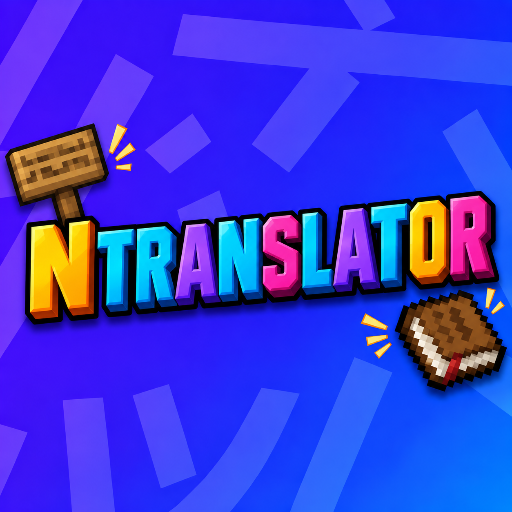

<h1>NTranslator</h1>

Interface de leitura para placas e livros, com narração local no Windows.

[Baixar os JARs](https://github.com/arthoou/ntranslator-minecraft/releases/tag/builds-2026-11-16) · [Versões](#versões) · [Créditos](#créditos)

## Versões

Escolha o JAR da versão exata do Minecraft e do loader que você usa. Cada variante tem instruções próprias de instalação, uso e compilação.

| Loader | Minecraft | Java | Versão do mod | Guia e código |
| --- | --- | --- | --- | --- |
| Fabric | 1.21.1 | 21 | 2.0-beta | [Abrir `fabric/1.21.1`](fabric/1.21.1/README.md) |
| Fabric | 1.20.1 | 17 | 2.0-beta | [Abrir `fabric/1.20.1`](fabric/1.20.1/README.md) |
| Fabric | 1.18.2 | 17 | 2.0-beta | [Abrir `fabric/1.18.2`](fabric/1.18.2/README.md) |
| Forge | 1.21.1 | 21 | 2.0-beta | [Abrir `forge/1.21.1`](forge/1.21.1/README.md) |
| Forge | 1.20.1 | 17 | 2.0-beta | [Abrir `forge/1.20.1`](forge/1.20.1/README.md) |
| Forge | 1.18.2 | 17 | 2.0-beta | [Abrir `forge/1.18.2`](forge/1.18.2/README.md) |
| NeoForge | 1.21.1 | 21 | 2.0-beta | [Abrir `neoforge/1.21.1`](neoforge/1.21.1/README.md) |

## Compilar

Abra a pasta da variante que você quer compilar, use o Java indicado na tabela e siga o comando no guia dessa versão.

## Créditos

Desenvolvimento, adaptações ou ports por [Arthou](https://github.com/arthoou). Cada guia acima detalha os créditos, bibliotecas e recursos usados naquela variante.
