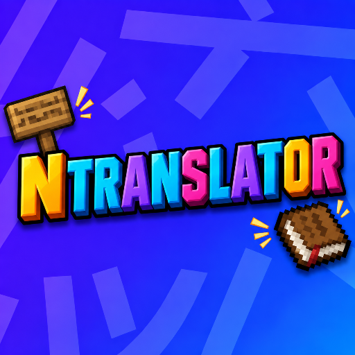

<div align="center">



<h1>NTranslator</h1>
<p>Interface de leitura para placas e livros, com narração local no Windows.</p>
<p><strong>Minecraft 1.18.2 · Fabric · Java 17</strong></p>

</div>

[Instalação](#instalação) · [Uso](#uso) · [Como funciona](#como-funciona) · [Créditos](#créditos)

## Instalação

Coloque o JAR `build/libs/ntranslator-fabric-1182-2.0-beta.jar` na pasta `mods/` do cliente. Instale também **Fabric API** para esta versão do Minecraft. Em multiplayer, a instalação é feita apenas na sua instância.

| Minecraft | Loader | Java | Versão do mod |
| --- | --- | --- | --- |
| 1.18.2 | Fabric 0.16.14 | 17 | 2.0-beta |

## Uso

1. Clique com o botão direito em uma **placa** para abrir a tela de leitura. Para editar normalmente, clique agachado ou com uma placa na mão.
2. Abra um **livro escrito** ou **livro e pena** para encontrar os controles de idioma e leitura na tela.
3. No **Windows**, acione o alto-falante para ouvir o texto com uma voz local do sistema.

## Como funciona

A tela de placas mostra as linhas da face selecionada. Em livros, o mod acrescenta atalhos à interface nativa. O build atual mostra o texto original quando a tradução está indisponível. O seletor salva a preferência de idioma em `config/ntranslator.json`.

A leitura em voz alta usa a voz instalada no Windows e pode ser interrompida ao fechar a tela de leitura. O JAR distribui os controles para placas e livros no cliente.

## Créditos

Desenvolvimento e port por [Arthou](https://github.com/arthoou).

## Compilar

Use um JDK 21 para executar o Gradle e um JDK 17 disponível para a toolchain de compilação desta variante. Para jogar, use o Java indicado na tabela de instalação.

```bash
java -classpath gradle/wrapper/gradle-wrapper.jar org.gradle.wrapper.GradleWrapperMain build
```

A saída de distribuição aparece no caminho indicado em **Instalação**.
